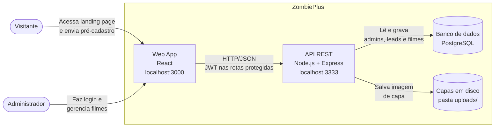
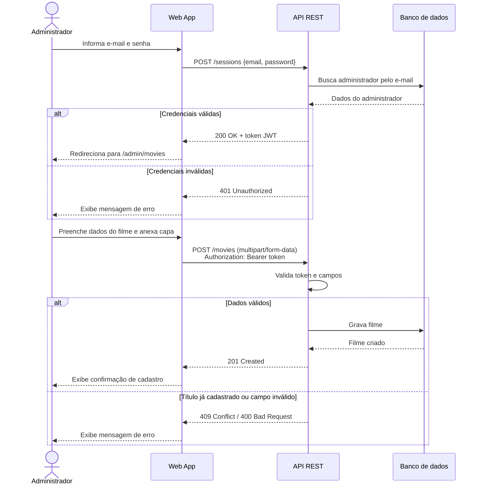

# ZombiePlus: discovery de documentação

Repositório de estudo da pós-graduação em Engenharia de Software (UFG). O objetivo é documentar o ZombiePlus usando a abordagem *diagrams as code*, com diagramas em Mermaid versionados junto com o texto.

> O ZombiePlus é a aplicação usada no curso de automação de testes com Playwright. Eu não sou o autor do sistema; esta documentação foi construída a partir do que observei usando a aplicação e escrevendo testes para ela.

## 1. Descrição do sistema

### Escopo

O ZombiePlus é uma plataforma fictícia de streaming de filmes de terror. Esta documentação cobre duas jornadas:

- **Visitante:** acessa a landing page e faz o pré-cadastro (lead) para receber uma oferta de lançamento.
- **Administrador:** faz login na área administrativa e gerencia o catálogo de filmes, incluindo o envio da imagem de capa.

Fica fora do escopo: reprodução de vídeo, pagamento e assinatura (a landing page mostra preços, mas não há fluxo de compra).

### Nível da visão

Nível 2 do modelo C4 (contêineres): mostra as aplicações e o armazenamento de dados, sem detalhar componentes internos de cada um.

### Limites e responsabilidades

| Contêiner | Responsabilidade |
|---|---|
| Web App | Interface da landing page e da área administrativa. Não guarda dados, apenas consome a API. |
| API | Autenticação, regras de negócio e persistência de leads e filmes. |
| Banco de dados | Armazena usuários administradores, leads e filmes. |

### Integrações

- Web App → API via HTTP/JSON.
- Rotas protegidas exigem token JWT no header `Authorization: Bearer <token>`, obtido em `POST /sessions`.
- O cadastro de filme envia a capa em `multipart/form-data`.

### Restrições

- Ambiente local de estudo: Web App em `localhost:3000` e API em `localhost:3333`.
- Sistema de treinamento, sem requisitos reais de escala, disponibilidade ou segurança de produção.

### Detalhes confirmados no código da API

Na primeira versão, estes pontos eram lacunas que eu não conseguia confirmar só usando a aplicação. Depois li o código da API e confirmei:

- API em Node.js com Express. Banco PostgreSQL acessado via Sequelize.
- As capas são salvas em disco, na pasta `uploads` da API, e o banco guarda só o nome do arquivo.
- Rotas: `POST /leads` (pública), `GET /leads` e `GET`/`DELETE /leads/:id`; `POST /movies`, `GET /movies` e `GET`/`DELETE /movies/:id` (protegidas).
- Validação: campos obrigatórios ausentes ou vazios retornam 400. E-mail de lead duplicado retorna 409; título de filme duplicado também retorna 409.
- O token JWT expira em 10 dias.

## 2. Diagrama estrutural: contêineres (inspirado no C4)

## 3. Diagrama comportamental: administrador cadastra um filme

Escolhi esta jornada porque é a mais crítica do sistema: envolve autenticação, envio de arquivo e gravação no banco.

## 4. Decisões e ajustes sobre o que a IA gerou

Os diagramas e a descrição foram gerados com apoio de IA generativa a partir da minha descrição do sistema. Esta tabela registra o que eu revisei.

| Item gerado pela IA | Situação | O que eu fiz |
|---|---|---|
| Web App em React | Confirmado | Vi as classes `sc-...` do styled-components no DevTools. |
| Login em `POST /sessions` retornando JWT | Confirmado | Testei no Postman e usei o token como Bearer. |
| Upload de capa em `multipart/form-data` | Confirmado | Enviei pelo Postman com body form-data. |
| API em Node.js e banco PostgreSQL | Confirmado (código-fonte) | Li o código da API: Node.js com Express e banco PostgreSQL via Sequelize (driver `pg`, porta 5432). |
| Rota `POST /movies` | Confirmado (código-fonte) | Exige token. Recebe `title`, `overview`, `release_year`, `company_id` e `featured` (todos obrigatórios) e `cover` (opcional). Retorna 201. A IA não tinha como saber que `featured` é obrigatório. |
| Respostas 409 e 400 no cadastro de filme | Confirmado (código-fonte) | Título duplicado: 409 com `bcode 1001`. Campo obrigatório ausente ou vazio: 400 "Validation fails". Achado que a IA não previu: empresa inexistente também retorna 400 ("Company not found."). |
| Armazenamento das capas | Confirmado (código-fonte) | Disco local: o multer salva o arquivo na pasta `uploads` da API, e o banco guarda só o nome do arquivo. |

Decisões que tomei sobre o formato:

- Usei `flowchart` do Mermaid para a visão de contêineres em vez da sintaxe `C4Container`, que ainda é experimental e às vezes renderiza com layout ruim no GitHub.
- Na primeira versão, marquei no próprio diagrama o que era inferência, em vez de apresentar tudo como fato. Depois de confirmar esses pontos no código da API, troquei as marcações pelos valores reais.

## 5. O que falta para um agente implementar o sistema sem inventar decisões

- Contrato da API (OpenAPI) com rotas, payloads, códigos de resposta e mensagens de erro.
- Modelo de dados: entidades, campos, tipos e restrições de unicidade.
- Regras de negócio escritas como critérios de aceitação (por exemplo, em Gherkin).
- Requisitos não funcionais, mesmo que simples: tamanho e formato máximo da capa.
- Decisões registradas em ADRs, como a escolha de JWT e do formato de armazenamento das capas.
